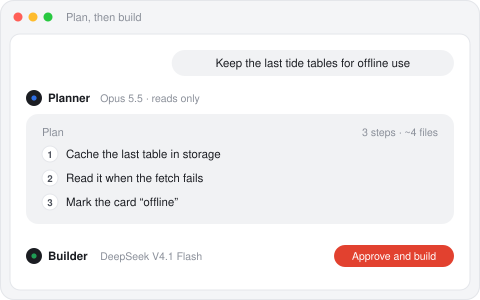
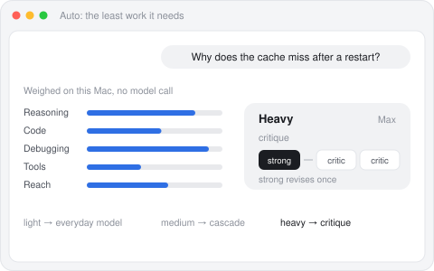

<div align="center">


# Liner Code

**Your coding agents, with a real app around them.**

Claude Code, Codex, OpenCode and Hermes on your desktop, with your own sign-ins:
plans you approve, a diff for every turn, a check from another maker, and the work split
so the expensive model only works when the job needs it.

[](https://github.com/lynnarize/liner-code/releases/latest)
[](https://github.com/lynnarize/liner-code/releases)
[](CHANGELOG.md)
[](LICENSE)
<br>
[](#install-the-alpha)
[](#install-the-alpha)
[](desktop/)
[](ui/)
[](engine/)
[](https://github.com/lynnarize/liner-code/stargazers)

[](https://github.com/lynnarize/liner-code/releases/latest)
&nbsp;
[](https://github.com/lynnarize/liner-code/releases/latest)

[Install](#install-the-alpha) · [Features](#features) · [How agents share the work](#how-agents-share-the-work) · [Designs](#designs) · [API endpoints](#api-endpoints) · [Run from source](#run-it-from-source) · [Changelog](CHANGELOG.md)

<br>

<picture>
  <source media="(prefers-color-scheme: dark)" srcset=".github/readme/hero-dark.jpg">
  
</picture>

</div>

## What it is

A desktop agent harness for macOS and Windows, on Electron. It drives the coding agents already on your
machine (Claude Code, Codex CLI, OpenCode, Hermes) with your own sign-ins, and shows their work
as GUI instead of a log: plans you approve, questions you answer, requests that wait as cards,
a diff for every turn that you can undo or commit or question line by line, a Reviewer from
another model family, surfaces beside the session (Terminal, Browser, Design, Files, Pull request,
Device, Routines), models compared side by side, and sessions that sort themselves by what they
need from you. It's built from [Liner UI](https://linerui.sorafel.com), so it has Liner's look and motion:
white paper on one solid ground, glass only on the session tray, one accent, text that comes into
focus, springs that never overshoot.

<table>
  <tr>
    <td align="center"><b>Claude Code</b><br><sub>Agent SDK</sub></td>
    <td align="center"><b>Codex CLI</b><br><sub>app server</sub></td>
    <td align="center"><b>OpenCode</b><br><sub>ACP</sub></td>
    <td align="center"><b>Hermes</b><br><sub>ACP</sub></td>
    <td align="center"><b>Cursor · Grok Build</b><br><sub>ACP, beta</sub></td>
    <td align="center"><b>API endpoints</b><br><sub>DeepSeek, Kimi, GLM, OpenRouter, Ollama…</sub></td>
  </tr>
</table>

## Features

<table>
  <tr>
    <td width="33%" valign="top">
      
      <b>Plan, then build</b><br>
      <sub>A hard job goes to the frontier model to plan; a cheaper one builds it in the same turn.</sub>
    </td>
    <td width="33%" valign="top">
      
      <b>Every turn is a diff</b><br>
      <sub>A git snapshot before and after each turn: undo it, commit it, or ask about a line.</sub>
    </td>
    <td width="33%" valign="top">
      
      <b>Checked by another maker</b><br>
      <sub>GPT reads Claude's change (and Claude the rest) against five fixed criteria.</sub>
    </td>
  </tr>
  <tr>
    <td width="33%" valign="top">
      
      <b>Auto routing</b><br>
      <sub>Each message is weighed on your machine, then gets one model, a cascade or a critique.</sub>
    </td>
    <td width="33%" valign="top">
      
      <b>Designs beside the session</b><br>
      <sub>Any agent draws a screen; point at a part to change it, then Build it.</sub>
    </td>
    <td width="33%" valign="top">
      
      <b>Surfaces</b><br>
      <sub>Terminal, Browser, Design, Files, Pull request, Device and Routines, one click away.</sub>
    </td>
  </tr>
  <tr>
    <td width="33%" valign="top">
      
      <b>The Desk</b><br>
      <sub>Sessions sort themselves: back with you, out with agents, done.</sub>
    </td>
    <td width="33%" valign="top">
      
      <b>Models side by side</b><br>
      <sub>One prompt to the models you have, with what each cost, and keep the best.</sub>
    </td>
    <td width="33%" valign="top">
      
      <b>Workshop</b><br>
      <sub>Ask for what Liner Code doesn't have; an agent makes it as an add-on.</sub>
    </td>
  </tr>
</table>

## Screenshots

<table>
  <tr>
    <td width="50%">
      <picture>
        <source media="(prefers-color-scheme: dark)" srcset=".github/readme/desk-dark.jpg">
        
      </picture>
      <p align="center"><sub><b>The Desk</b>: every agent's work in one place</sub></p>
    </td>
    <td width="50%">
      <picture>
        <source media="(prefers-color-scheme: dark)" srcset=".github/readme/plan-dark.jpg">
        
      </picture>
      <p align="center"><sub><b>Plans</b>: approve it, then it builds</sub></p>
    </td>
  </tr>
  <tr>
    <td width="50%">
      <picture>
        <source media="(prefers-color-scheme: dark)" srcset=".github/readme/diff-dark.jpg">
        
      </picture>
      <p align="center"><sub><b>Diffs</b>: every turn, undoable</sub></p>
    </td>
    <td width="50%">
      <picture>
        <source media="(prefers-color-scheme: dark)" srcset=".github/readme/pr-dark.jpg">
        
      </picture>
      <p align="center"><sub><b>Pull requests</b>: checks and reviews beside the session</sub></p>
    </td>
  </tr>
</table>

<sub>Screenshots are the real app on a sample project (0.1.2 and 0.1.5, with a scripted demo agent);
the feature pictures above are wireframes. Both follow your system's light or dark theme.</sub>

Ideas came from [T3 Code](https://github.com/pingdotgg/t3code) (MIT) and
[Hermes Agent](https://github.com/nousresearch/hermes-agent) (MIT); no code was copied from either.
The Design surface takes ideas from [Kun](https://github.com/KunAgent/Kun)'s Design mode
(PolyForm Noncommercial), and from T3 Code's HTML previews; no code was copied from them either.

## Install the alpha

Liner Code is in **alpha** (0.2.x): for Macs with Apple Silicon, tried on macOS 27, and expect
rough edges. Download `Liner-Code-<version>-mac-arm64.dmg` from
[Releases](https://github.com/lynnarize/liner-code/releases), open it and drag Liner Code to
Applications. The alphas aren't notarized by Apple yet, so the first open is blocked: open
System Settings › Privacy & Security, press **Open Anyway** beside Liner Code, and confirm. (Or, in
Terminal: `xattr -dr com.apple.quarantine "/Applications/Liner Code.app"`.) After that it updates
itself from this repository's releases.

**On Windows** (x64, new in 0.1.9): download `Liner-Code-<version>-win-x64.zip`, unzip it anywhere
and open `Liner Code.exe`; it puts itself in the Start menu. It isn't signed yet, so SmartScreen
asks the first time: **More info › Run anyway**. It doesn't update itself yet, so download the next
zip, and its Terminal is PowerShell, without full-screen programs for now. Building it from a Mac:
`npm run win`.

You need at least one coding tool installed and signed in: [Claude Code](https://code.claude.com),
[Codex CLI](https://github.com/openai/codex), [OpenCode](https://opencode.ai) or
[Hermes](https://github.com/nousresearch/hermes-agent). Git and the Terminal need Apple's command
line tools; first run says so if they're missing.

Found something? **Help › Report a Problem…** makes a zip with the log and versions and opens an
[issue](https://github.com/lynnarize/liner-code/issues/new/choose).

## Your accounts and your data

- **Sign-ins stay with each tool.** Liner Code runs the tools you installed, unmodified, and asks
  them only whether they're signed in (`claude auth status`, `codex login status`); "Sign in"
  opens the tool's own login in Terminal. It never sees, stores or forwards a sign-in.
- **API keys** you add (an endpoint's too) are sealed in this Mac's keychain and handed to the
  tool's process in memory. For Claude, Anthropic asks apps built on its Agent SDK to use an API key (see its
  [terms](https://code.claude.com/docs/en/legal-and-compliance)), so Settings › Models lets Claude
  Code bill to your Anthropic key.
- **Nothing in between.** Model traffic goes from each tool to its own provider and is billed to
  your account. Liner Code has no server, no telemetry and no analytics. Besides its own releases from GitHub and
  the tools' versions on npm, it fetches the Agent Client Protocol registry when you look for
  agents to add, and reaches GitHub through your `gh` sign-in for pull requests and routines
  (which look every 5 minutes while one is on). Hermes's own update check runs a `git fetch`.
- **Changes are checked by another maker.** Each change in Solo and Plan is read by another maker's
  model by default: GPT for Claude's work, Claude for the rest. So with Claude Code and Codex both
  here, diffs Claude writes also go to OpenAI through Codex, billed to that account. Set After each
  change to Refine or Off in Settings › Agentic features, or for one session from its composer.
- **Everything else is on this Mac**: sessions, snapshots and settings in `~/.liner-code` (see
  Where things live).

## Run it from source

```bash
npm install
npm run dev          # the engine on :7317 and the app on http://localhost:5179
npm run app:dev      # the Electron window against npm run dev (run both)
npm run app          # the Electron window from the repo, with its own engine
npm run mac          # builds build/Liner Code.app (Electron, about 300 MB)
npm run mac -- --open
npm run release      # the app zipped for GitHub Releases, with its SHA-256 (see Updates below)
npm run typecheck
npm test             # the engine's tests (node:test)
```

`npm run dev` keeps sessions in `~/.liner-code`; set `LINER_HOME` to use another folder (the
window then keeps its own data under `$LINER_HOME/shell` too, so it runs beside your app).
`LINER_INSPECT=1` turns on the Web Inspector, Reload and Inspect Element. The app runs its engine
on Electron's own Node, so it needs no Node installed; building it needs Node 24 and Xcode's
command line tools (for the Mac addon and the icon).

The first launch plays the intro, then three steps: connect models (it finds the CLIs you have),
add projects (it finds your Git repositories), and how you'll work (Solo, Plan then build, or
Auto). The **Demo**, a scripted agent with its own **Sample project**, runs
every flow with no account at all. It's hidden: tap your name at the foot of the sidebar six times
to show it (and six more to hide it again).

## How agents share the work

A session works in one of three **modes**, and in all three one model writes at a time
(`engine/src/runtime.ts`, `route.ts`, `review.ts`). Agents are optional: every part is a bare
model unless you pick one of your agents, which you make when a model should carry instructions
of its own (a soul.md, a prompt, skills, context files).

```
 Solo             You ──► one model (or one of your agents) ──► check or refine ──► yours

 Plan, then build You ──► a hard job? ──► Planner (reads only) ──► plan ──► Builder builds it
                    │                        (waits for your OK only if you asked)      │
                    └──► anything else ──► Builder, at once                             │
                                         check (another maker) or refine (frontier) ──► yours

 Auto             You ──► weigh the message ──► single · cascade · critique (below)
```

**Plan, then build.** Most messages go straight to the builder, so work starts at once. A hard
job (weighed from its words, on this Mac) goes to the planner first, which reads and ends its reply
with a plan, and the builder builds it straight after, in the same turn. A plan waits for your OK
only when you ask for one ("plan it first") or turn on Approve plans first. The
two keep sessions of their own, and each turn starts with what the other said since its last
one, so neither works from a conversation that moved on.

**Hand-offs you don't see.** A plan built, a draft refined, a fix after a check: each carries your
turn on rather than starting one of its own, so the timeline shows one turn with one footer for
all its changes, and the other models only as small marks on its head (point at them to see who
did what, and why). Nothing on the timeline announces a switch; "done" is said once, when
everything your message set off is done.

**Which models.** You pick two, and everything else follows from them:

| | Frontier | Cheaper |
| --- | --- | --- |
| Plan, then build | plans | builds, answers questions |
| Auto | hard jobs, repairs | most messages |
| Solo | | starts on it |
| After each change | refines (Refine) | |

Each starts on Automatic, which says what it lands on: for frontier, Opus, else GPT Astra or Sol,
Gemini Pro, Grok, DeepSeek V4 Pro, Kimi K3, Qwen Max, GLM or MiniMax; for cheaper, GPT Luna, else
Sonnet, Gemini Flash, DeepSeek Flash, GLM Flash or Qwen Flash. Models are told apart by who made
them, from their names, so GPT Astra counts as OpenAI's whether it runs in Codex, Hermes or an API
endpoint, and each maker's models come from its own tool first (Claude Code for Claude, Codex for
GPT). Any model a tool here runs can be picked, Chinese ones through OpenCode, Hermes or an
endpoint included, and none of it needs a Claude or ChatGPT subscription: with only OpenCode Go,
DeepSeek Flash builds, DeepSeek V4 Pro plans and Kimi checks. The picker goes tool, then source
(Hermes's Nous Portal or OpenCode Go), then model, so a tool with a hundred models is two short
lists. **Dual frontier** puts a second frontier model from another maker in the cheaper one's
place (GPT Astra building next to Opus), for the hardest work.

**After each change.** In Solo and Plan, a change goes one of three ways before it's yours:

- **Check** (the default): another maker reads it against five fixed criteria; blocking findings
  go back to the writer, up to 2 rounds (3 at most), then it's yours.
- **Refine**: the frontier model takes the cheaper one's draft on and finishes it, in a session of
  its own: a Chinese model builds the first pass, Opus fine-tunes it. When the frontier model
  wrote the change itself, it's checked instead.
- **Off**: yours as it is.

A few lines, or docs alone, go through as they are unless you turn that on. Auto has its own
judge and critics.

**Inside Claude Code**, a writer (an agent or a bare model) brings two helpers on Haiku: an
Explorer that reads, greps and maps the code, and a Test runner that runs the tests and reports
the first useful line. One of your agents can run alone instead.

**Auto** (`engine/src/route.ts`) has no fixed team: each message is scored from its own words
(reasoning, writing code, debugging, tools, how far it reaches) and weighed light, medium or
heavy. That happens on this Mac with no model call, so it costs nothing. The first rule that fits
picks the pattern:

```
 message ─► score its words ─► light / medium / heavy ─► rule ─► pattern
                                                                   │
   single    ┌──────────┐                                          │
             │ everyday │  or the strong model alone, for a hard job
             └──────────┘
   cascade   ┌──────────┐    ┌───────┐  pass ─► done
             │ everyday │ ─► │ judge │
             └──────────┘    └───────┘  fail ─► strong model repairs ─► judge once more
   critique  ┌────────┐    ┌──────────┐ ┌──────────┐
             │ strong │ ─► │ critic 1 │ │ critic 2 │ ─► strong revises once
             └────────┘    └──────────┘ └──────────┘
```

| Level | Light job | Medium job | Heavy job |
| --- | --- | --- | --- |
| Standard | everyday alone | everyday alone | strong alone |
| High | everyday alone | cascade | critique, 1 critic |
| Max | cascade | critique, 1 critic | critique, 2 critics |

Questions go to the everyday model at every level (the strong one for a hard question on High
and Max).

### What keeps the cost down

- **The expensive model works only when the job needs it.** In Plan it only reads and plans; in
  Auto the everyday model takes light and medium jobs and the strong one comes in for heavy jobs,
  or to repair what the judge failed.
- **Questions skip the planner.** A greeting or a question in Plan goes to the builder, so the
  frontier model isn't paid to say hello.
- **A judge reads instead of rewriting.** In a cascade the judge only reads the diff (or, when
  nothing changed, the answer) and passes it; the strong model writes only when it fails.
- **Haiku does the reading.** Explorer and Test runner keep long file reads and test output out
  of the writer's context, so the writer's model never pays for them.
- **Warm caches are kept.** A follow-up within five minutes of the last turn stays with the model
  already working, so it reads its prompt cache instead of the whole thread at full price. The
  composer shows when Claude's cache for the session is likely to run out.
- **Small things go to the quickest model.** Commit messages, pull request text and Reviewer
  decides (ALLOW or ASK for one step) run on Haiku or a mini model, not the session's own.
- **Checks have a limit.** At most 2 fix rounds by default (3 at most); after that it's yours.
- **A spending cap.** Settings › General › Spending can stop a session at a dollar amount; your
  next message is the go-ahead for another cap's worth. (Claude Code reports cost; other tools
  can't be held to it.)
- **You can see it all.** Every turn's tokens, cache reads and cost, by agent and model, go to
  `~/.liner-code/usage.jsonl`, the Usage page adds them up, and Settings › Agentic features
  compares the modes in your own sessions.

## Designs

Ask any agent for a screen, a page or a prototype and it draws it in the **Design** surface
beside the session (⌘⇧E), the same with Claude Code, Codex, OpenCode, Hermes, any ACP agent or a
model from an API endpoint (see API endpoints below):

```
 You: "Design the settings screen"
   │
   ▼
 Agent writes .liner/designs/settings.html          (its own Write/Edit tools; or hands the page over whole)
   │  design_show { title, path, size }            (Liner Code's MCP server, which every agent tool gets)
   ▼
 Liner Code keeps it as version n ───────────────► timeline card with a picture of it
   │  draws it out of sight at its size ─────────► the agent gets the picture, its height and its console errors back
   ▼
 Design surface: Desktop / Tablet / Phone, Live or any version, the code, light or dark
   │  pick a part and comment ─────────────────────► the agent gets the element and your words, edits, shows v(n+1)
   │  Build it ────────────────────────────────────► the agent builds it with the project's own components
   ▼  Bring back version 2 ────────────────────────► v2 goes back in the file, as v(n+1)
```

- **One file, edited in place.** A design is one self-contained HTML file in the session's folder
  (`.liner/designs/` by default). The agent changes it with its own edit tools, so a change costs
  an edit, not the whole page again; the surface draws each edit as it lands, the next drawing
  loading behind the one you see.
- **Not your project's changes.** `.liner/` goes in the repository's `info/exclude` with the first
  design and is left out of every turn's snapshot, so designs never show in the diff or a commit.
- **The agent sees what it drew.** `design_show` answers with a picture of the design at its size
  and as tall as it is (up to 2400 px), at its own pixels, with the errors it logged, so the agent
  can fix what's off before it says it's done.
- **No way into the app.** A version is drawn on its own with no origin; the live file comes from
  the session folder's own address on 127.0.0.1. A planner (which never edits) draws a design by
  handing over the page; asking for it to be built is a change it plans like any other.

## What's in it

<details>
<summary>The repository, folder by folder</summary>

```
contracts/src/index.ts     everything that crosses the wire: items, threads, events, RPC methods
engine/                    the local backend (Node, TypeScript run directly, one dependency)
  src/main.ts              starts the server; prints LINER_READY {"port":…} for the shell
  src/server.ts            127.0.0.1 only: GET /events (NDJSON stream), POST /rpc, the built app
  src/api.ts               one handler per command
  src/runtime.ts           runs turns: Solo, Plan (planner → plan → builder), Auto; approvals, questions, queue and steer, check or refine
  src/review.ts            the Reviewer's prompt and findings, who reviews whom, Claude run modes and subagents
  src/route.ts             routed sessions: each message scored and given one model, a cascade with a judge, or a critique
  src/routines.ts          routines: triggers, AI steps, the code gate, actions, test runs
  src/watch.ts             auto-settle and snooze until checks finish or someone replies
  src/updates.ts           Liner Code's releases on GitHub (download, check, stage) and the agent tools' own updaters
  src/surfaces.ts          files, the terminal (a Python pty bridge), gh pull requests, ports, the iOS Simulator
  src/proxy.ts             the Browser surface's proxy: console, element picking, offline
  src/designs.ts           designs: versions, the file each lives in, watching it, keeping .liner/ out of git
  src/agent-tools.ts       what agents reach of the app through mcp.ts: the Browser, the simulator, pages, designs, memory
  src/checkpoints.ts       a git snapshot before and after every turn (undo, diff, commit)
  src/store.ts             state.json plus an append-only log per thread
  src/providers/claude.ts  Claude Code through the Claude Agent SDK (canUseTool, resume, fork)
  src/providers/codex.ts   Codex through `codex app-server` (`codex exec --json` for an older Codex), models from its own catalog
  src/providers/acp.ts     any Agent Client Protocol agent: Hermes, OpenCode, Cursor and Grok Build (those two in beta), the ACP registry
  src/providers/demo.ts    a scripted planner and builder, and the sample project it edits
  src/providers/endpoint.ts  an API endpoint as a tool: Claude Code, Codex or OpenCode pointed at it, by protocol
ui/                        the app (React 19 + Vite), built from Liner UI
  src/liner/               the Liner UI library, copied in (npm run sync-liner refreshes it)
  src/app/                 Setup, Sidebar, Home, Session, Timeline cards, Composer, Panel and its surfaces
                           (Review, Files, Terminal, Browser, Design, Pr, Device, Routines, RoutineBuilder), Compare, Usage, Settings
desktop/                   the Electron shell
  src/main.ts              the window, the bridge the page calls, menus with your keys, notifications, the Dock badge
  src/engine.ts            the engine as a child process on Electron's own Node (ELECTRON_RUN_AS_NODE), restarts, your login PATH
  src/keys.ts              API keys sealed with safeStorage; the Swift shell's keychain items come over once
  src/update.ts            puts a downloaded release in the app's place when you restart or quit
  src/preload.ts           window.__LINER__ and window.linerShell for the page, the traffic lights' place as CSS variables
  native/mac.mm            a Node-API addon: vibrancy or Liquid Glass behind the sidebar column only, the traffic lights' frames,
                           the trackpad's tap, and Apple Intelligence's badge kept off text fields
  build.ts, package.ts     bundles the shell and compiles the addon; wraps the app with @electron/packager
mac/                       the older Swift shell (npm run mac:swift builds it into build/swift/)
scripts/                   dev runner, Mac build, release, icon, Liner sync
engine/test/               node:test tests for the engine's pure parts and the proxy
docs/BACKEND.md            what the backend needs, now and later
```

</details>

## Where things live

<details>
<summary>Every file Liner Code keeps, and where</summary>

| What | Where |
| --- | --- |
| Projects, threads, agents, settings, groups | `~/.liner-code/state.json` |
| Routines and their runs | `~/.liner-code/routines.json` |
| Scratch sessions with no project | `~/.liner-code/Scratch` (a Git repo) |
| Each thread's timeline | `~/.liner-code/threads/<id>.jsonl` |
| Tokens and cost per turn | `~/.liner-code/usage.jsonl` |
| Worktrees, attachments | `~/.liner-code/worktrees/`, `~/.liner-code/attachments/` |
| Turn snapshots | `refs/liner/<thread>/<turn>-before|after` in each repo |
| A design's file, and its versions | `.liner/designs/` in the session's folder; `~/.liner-code/designs/<thread>/<design>/v<n>.html` |
| API keys | `~/Library/Application Support/Liner Code/keys.json`, sealed with a key macOS keeps in the login keychain as "Liner Code Safe Storage" (the engine gets them in memory only) |
| The window's frame and material | `~/Library/Application Support/Liner Code/shell.json` |
| Engine log | `~/Library/Logs/Liner Code/engine.log`, and `engine.previous.log` from the launch before (a test home's own: `$LINER_HOME/logs`) |
| A downloaded update, waiting to go in | `~/.liner-code/updates/` |

</details>

## Updates

Liner Code keeps itself and the agent tools current; both show on Home's corner and in
Settings › Updates, each set to Automatically, Just tell me, or Off. Liner Code itself starts on
Automatically. The tools are yours, so they start on Just tell me.

- **Liner Code** looks at the latest release of its GitHub repository a few seconds after it opens
  and every six hours. It downloads the zip for this Mac, checks it against the release's SHA-256
  (GitHub's own digest, or the `.sha256` file beside the zip), unpacks it and checks it again
  (bundle id, version, signature), then puts it in place when you press Restart to update, or
  when you quit. If it can't take the old copy's place, it says why next time it opens and links
  the release page instead of trying again at every quit. A copy run from source, from a folder
  you can't write to, or from Downloads without being moved to Applications says so and links the
  release page instead. A private repository is read with the GitHub CLI's sign-in.
- **The agent tools** (Claude Code, Codex, OpenCode, Hermes, Grok Build) are compared with where
  each is published (npm; Hermes asks itself). When you press Update (or by themselves, set to
  Automatically), they're updated with their own updaters (`claude update`, `codex update`,
  `opencode upgrade`, `hermes update --yes`), one at a time and only while no session is working
  on that tool. Its idle sessions restart after, and resume where they were.

To publish a release: the repository is package.json's `"repository"`, or else this checkout's
GitHub origin (`npm run mac` writes it into the app, so build after adding it). Then:

```bash
npm run release -- 0.2.0             # sets the version, builds, zips, writes the .sha256
npm run release -- 0.2.0 --publish   # …and creates the release v0.2.0 with gh
```

## Agents and models

| Provider | How | Approvals | Resume | Notes |
| --- | --- | --- | --- | --- |
| Claude Code | Claude Agent SDK, your installed `claude` | yes, every access level | yes, and real forks | plans with ExitPlanMode, asks with AskUserQuestion |
| Codex CLI | `codex app-server` | yes: commands, edits and MCP tools (an older Codex's `exec` maps access to its sandbox) | yes | models come from `codex debug models` |
| OpenCode | ACP over stdio | yes | when the agent can | any model OpenCode is set up with |
| Hermes | ACP over stdio | yes | yes | depends on Hermes's own provider being up |
| Cursor, Grok Build | ACP (`cursor-agent acp`, `grok agent stdio`) | yes | when the agent can | Beta: the drivers haven't been run against the real tools yet |
| Demo | scripted | yes | – | edits only its sample project |
| API endpoints | through Claude Code, Codex or OpenCode, by protocol | as that tool | as that tool | Settings › Models › API endpoints |

### API endpoints

Models from an API (DeepSeek, Kimi, GLM, OpenRouter, a model in LM Studio or Ollama) run through
the tool that speaks the endpoint's protocol, pointed at it, so they get everything that tool
does (files, commands, approvals, resume) and Liner Code's own tools (the Browser, designs),
with no agent loop of Liner Code's own (`engine/src/providers/endpoint.ts`):

| The endpoint speaks | Runs through | How it's pointed there |
| --- | --- | --- |
| Anthropic Messages | Claude Code | `ANTHROPIC_BASE_URL` and `ANTHROPIC_AUTH_TOKEN`; its model for every alias (Sonnet, Haiku, subagents); tool search off, so every tool is in the list |
| OpenAI Responses | Codex | a model provider of its own (`-c model_provider=…`, `wire_api = "responses"`), given to its app server at start |
| OpenAI Chat Completions | OpenCode | a provider of its own in `OPENCODE_CONFIG_CONTENT` (`@ai-sdk/openai-compatible`) |

Add one in Settings › Models › API endpoints. Pick its service and the address and protocol fill
in (`ui/src/app/services.ts`, each address checked against the service): Anthropic, DeepSeek,
Kimi, GLM (Z.ai and Zhipu) and MiniMax through Claude Code; OpenAI and xAI through Codex;
OpenRouter, Gemini, Qwen, Groq, Mistral, Together, Fireworks, SiliconFlow, NVIDIA NIM and Ollama
Cloud through OpenCode; LM Studio, Ollama, LiteLLM or vLLM on this Mac. Or give any other
service's address and protocol. Then its key and its models (**Find its models** asks its
`/models`). It shows in the model picker as a tool
of its own. Its key is sealed in the keychain with the others and goes only to that tool's
process, under a variable of its own; your Anthropic key never goes to another maker's endpoint,
and Claude Code's own sign-in isn't sent there either. One on this Mac needs no key.

## Licence

MIT, see [LICENSE](LICENSE). The app also contains other people's software under their own terms,
listed in [THIRD_PARTY_NOTICES.md](THIRD_PARTY_NOTICES.md); the Claude Agent SDK inside it is
Anthropic's and isn't covered by the MIT licence. Tool and model names belong to their owners, and
Liner Code isn't made or endorsed by any of them.
